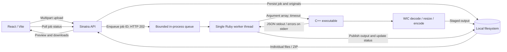

# Local Image Optimizer

A Windows image-processing application with a React interface, a Ruby/Sinatra API, and a C++ command-line processor built on Windows Imaging Component (WIC). Upload a batch, resize within a bounding box, compare results, and download individual files or a ZIP.

This is a **local, single-user application**. The API binds to loopback and is not designed for public internet hosting.

## Verification status

The API fixture tests, Chromium browser tests, and frontend production build have been executed on macOS. They verify orchestration and UI behavior using a deterministic subprocess **in place of WIC**.

**Windows verification passed** for implementation commit `4530992` in [GitHub Actions](https://github.com/AshSiva17/Local-Image-Optimizer/actions/runs/42960046389): MSVC x64 compilation, 48 native format/quality cases, Unicode and invalid-input checks, 14 API reliability tests (286 assertions), and 2 real-WIC API integration tests (51 assertions). The run also generated and uploaded a [48-case benchmark report](https://github.com/AshSiva17/Local-Image-Optimizer/actions/runs/42960046389/artifacts/13828573753). CI artifacts expire after 30 days; preserve the report when publishing a release.

This verifies the Windows Server 2022 x64 runner target. Manual Windows 10/11 UI checks remain a separate release step. See [release checks](docs/RELEASE.md).

## Architecture



- `frontend/`: React 19 and Vite; upload controls, 1800 × 1800 preset, progress polling, split comparison, and downloads.
- `backend/`: Sinatra API, atomic JSON job storage, a bounded queue, and a single background worker. Calls C++ without a shell and applies a per-file timeout.
- `native/`: C++17 processor using COM/WIC; performs decode, aspect-preserving scaling, pixel conversion, and encoding. Encoder pixel format is negotiated before conversion.
- `scripts/`: Windows build, deterministic image corpus, independent decoder assertions, native integration tests, and benchmarks.

There is no database or separate job broker. A storage lock prevents multiple API processes from sharing the same data directory. Job state survives on disk, but unfinished work is marked failed after a restart rather than resumed.

## Supported images and controls

Input and output formats are **PNG, JPEG, BMP, and TIFF**; “keep source” preserves the decoded format. Upload extensions: `.png`, `.jpg`, `.jpeg`, `.bmp`, `.tif`, `.tiff`. Actual image content is validated by WIC; an allowed extension alone is not sufficient.

- Resize using maximum width and/or height. Defaults in the UI are 1800 × 1800. This is a bounding box, not a crop: a 2400 × 1200 image becomes 1800 × 900. Smaller images are never upscaled.
- Quality accepts integers **1–100**. JPEG uses WIC `ImageQuality` (visual fidelity); TIFF uses `CompressionQuality` (compression effort). PNG and BMP ignore quality. TIFF effort does not imply a guaranteed size difference. See Microsoft's [encoder overview](https://learn.microsoft.com/en-us/windows/win32/wic/-wic-creating-encoder) and [TIFF encoder options](https://learn.microsoft.com/en-us/windows/win32/wic/tiff-format-overview).
- A batch supports up to 50 images, 50 MiB per image. The native processor rejects images above 100 million decoded pixels.
- A comparison preview requires browser support for both formats; TIFF commonly requires downloading to inspect.

## Install and run on Windows

Prerequisites:

- Windows 10/11 x64; CI targets Windows Server 2022 x64.
- Visual Studio 2022 Build Tools with **Desktop development with C++**, Windows SDK, and CMake tools (CMake 3.24+).
- Ruby 3.3 with RubyInstaller Devkit and Bundler (`gem install bundler`). The project supports Ruby 3.2+; CI uses 3.3.
- Node.js 22 LTS. Vite requires Node 20.19+ or 22.12+.

From the repository root, build the native processor:

```powershell
.\scripts\build-native.ps1
```

Alternatively, from a Visual Studio developer shell with CMake on PATH:

```powershell
cmake -S native -B native/build -A x64
cmake --build native/build --config Release
```

Both paths produce `native/build/Release/image_optimizer.exe`. Use a fresh build directory when switching CMake generators.

In one terminal, start the API:

```powershell
cd backend
bundle install
bundle exec rackup -o 127.0.0.1 -p 4567
```

In a second terminal, start the UI:

```powershell
cd frontend
npm ci
npm run dev
```

Open [localhost:5173](http://localhost:5173). Vite proxies `/api` to `127.0.0.1:4567`. `npm run build` checks and creates the frontend bundle; `npm run preview` can preview that bundle with the API still running. This repository does not configure public production hosting.

The full pipeline cannot run on macOS/Linux because WIC is Windows-only. API fixture tests, UI tests, and frontend builds can run there.

## API and job behavior

- `GET /api/health`: reports API availability and whether the native executable exists. This is a presence check, not a successful processing check.
- `POST /api/jobs`: multipart `images[]`, `format` (`keep`, `jpeg`, `png`, `bmp`, `tiff`), `quality` (1–100; defaults to 82), and optional `max_width`/`max_height` (1–100000). Returns HTTP 202 and a job object. Invalid settings return 400; invalid upload sizes return 413. A full queue returns 503 and rolls back that request's stored files.
- `GET /api/jobs/:id`: returns job/file statuses, dimensions, byte counts, errors, and file URLs. Internal storage paths are omitted. Unknown jobs return 404.
- `GET /api/files/:job_id/:kind/:filename`: serves a recorded original or completed optimized file. Append `?download=1` for an attachment. Arbitrary filesystem paths are not accepted.
- `GET /api/jobs/:id/export`: downloads successful outputs as ZIP. Returns 409 while work is unfinished or if no outputs succeeded.

A job moves through `queued → processing → done`, or ends as `failed` if any file fails. Failed batches retain successful outputs for individual and ZIP downloads. File statuses are also tracked separately. The queue holds up to 16 waiting jobs; the worker processes one image at a time.

The UI blocks repeated clicks while submitting, retries failed polling requests, and remembers the last job ID when browser storage is available. Independently repeated POST requests create distinct jobs: the API does not provide an idempotency-key contract. After an uncertain upload response, a manual retry can create another job.

## Native CLI

```powershell
native\build\Release\image_optimizer.exe `
  --input sample.jpg `
  --output sample-optimized.jpg `
  --format jpeg `
  --max-width 1800 `
  --max-height 1800 `
  --quality 82
```

The CLI emits JSON metadata on stdout and errors on stderr, with a nonzero exit code on failure. It rejects existing output paths, including the input path, to avoid overwriting user data. It supports Unicode paths. Partial newly created outputs are removed on normal error unwinding; the API also stages outputs and cleans up failed/crashed processing files.

## Tests

API orchestration, failure handling, filesystem boundaries, and restart recovery (all platforms):

```sh
cd backend
bundle install
bundle exec ruby test/server_test.rb
```

Browser tests start isolated Sinatra/Vite servers and use the deterministic processor fixture. Stop any servers already using ports 4567/5173 first. Requires Ruby dependencies above and Node:

```sh
cd frontend
npm ci
npx playwright install chromium
npm test
npm run build
```

The browser suite tests upload → queue → download over real HTTP, partial failures, duplicate clicks, polling retries and refresh recovery, missing jobs, and blocked browser storage. Its fixture outputs are not real images; WIC and image decoding are tested separately on Windows.

Real native processing and real-native API integration (PowerShell on Windows, after building):

```powershell
.\scripts\test-native.ps1
$fixtures = Join-Path $env:TEMP ("optimizer-fixtures-" + [Guid]::NewGuid())
try {
  .\scripts\new-test-images.ps1 -Directory $fixtures
  $env:IMAGE_OPTIMIZER_FIXTURES = $fixtures
  Push-Location backend
  try { bundle exec ruby test/native_integration_test.rb } finally { Pop-Location }
} finally {
  Remove-Item Env:IMAGE_OPTIMIZER_FIXTURES -ErrorAction SilentlyContinue
  Remove-Item -LiteralPath $fixtures -Recurse -Force
}
```

The native suite performs 48 format/quality combinations using real generated files, validates file existence and byte counts, independently checks decoded dimensions and actual format GUIDs with GDI+, and tests portrait/landscape constraints, no upscaling, Unicode paths, invalid arguments, missing/corrupt/unsupported inputs, and overwrite protection. The Windows API suite downloads and independently decodes real outputs and ZIP entries, including a partially failed batch.

## Benchmarks

```powershell
.\scripts\benchmark-native.ps1 -Iterations 3 -Report benchmark-results/native.json
```

This generates a fixed-seed corpus and measures all four input/output formats at quality 1, 82, and 100, resizing 2400 × 1200 to 1800 × 900. The report includes sample/median wall time, input/output bytes, size change, corpus hashes, binary hash, source revision, OS, and CPU. CI publishes it only after real Windows tests succeed. A [measured Windows report](https://github.com/AshSiva17/Local-Image-Optimizer/actions/runs/42960046389/artifacts/13828573753) is available from the verified run; no universal speed or size-saving claim is implied. Read the [benchmark methodology](docs/BENCHMARKS.md) before quoting numbers.

## Storage, cleanup, and configuration

`backend/storage/` contains job JSON, originals, completed outputs, and cached ZIPs. It is ignored by Git. Job JSON and ZIPs are built in temporary files and published only when complete. Multipart upload files are reaped after responses. Failed upload transactions and failed native outputs are removed; startup recovery removes known processing/export/job temporary files and explicitly marked abandoned uploads under the storage lock. Completed files and their originals are retained.

To remove retained batches, **stop the API first**, then remove its storage directory. Do not delete job data while the worker is running. There is no automatic retention policy.

Environment variables:

- `IMAGE_OPTIMIZER_BIN`: full executable path; defaults to the Windows Release binary above.
- `IMAGE_OPTIMIZER_STORAGE`: storage directory; defaults to `backend/storage/`. Use a private local directory, not a network share.
- `IMAGE_OPTIMIZER_TIMEOUT`: positive per-file subprocess timeout in seconds; default 120.
- `FRONTEND_ORIGIN`: CORS origin; defaults to `http://localhost:5173`.
- `VITE_API_BASE`: optional API URL for a separately served UI, supplied when building the frontend. Same-origin `/api` is the default.

## Limitations and release gate

- The Windows Server 2022 x64 pipeline has passed CI. Require a green Windows job on each new release commit; manual Windows 10/11 UI verification remains outstanding.
- Run one API process, with no clustered/preloaded Puma workers. The queue is in-process, has no cancellation, and does not resume interrupted work. Disk exhaustion and abrupt power loss can require manual storage repair; filesystem rename is not a database transaction.
- This is not a multi-tenant service. There is no authentication, TLS termination, global disk quota, or request-body limit before multipart parsing. Keep the API on loopback; do not expose it to untrusted users or shared writable storage.
- WIC processes the first frame only. Multipage TIFFs, EXIF orientation, ICC/color metadata, and other source metadata are not preserved. Transparent images converted to JPEG are not composited onto a configurable background. Outputs can be larger than inputs.
- Chromium UI behavior is tested; other browsers and Windows ARM64 are not verified targets.
- No project license has been selected. The owner should choose one before advertising the repository as reusable open-source software.

See [release checks](docs/RELEASE.md) for the exact verification and manual steps remaining.
